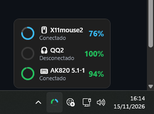
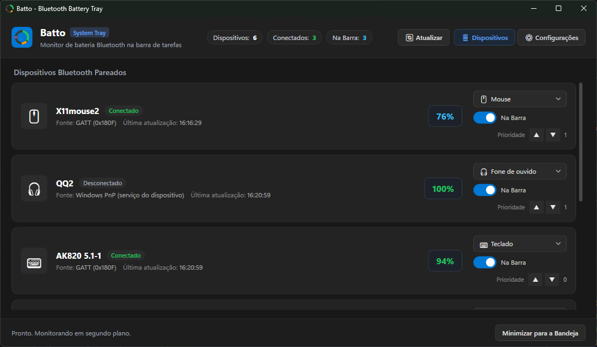

# Batto — Bluetooth Battery Tray ⚡

> Monitor nativo de bateria para dispositivos Bluetooth na barra de tarefas do Windows 10 e Windows 11.


---

## 🖼 Capturas de Tela

**Cartão ao passar o mouse sobre o ícone na bandeja**



**Janela principal com dispositivos pareados**



---

## 🎯 Objetivo Principal

O **Batto** exibe o nível de bateria dos seus fones, mouses, teclados e controles Bluetooth **diretamente na área de notificação da barra de tarefas (System Tray)**, ao lado do relógio do Windows, sem a necessidade de manter janelas abertas ou clicar em menus.

Exemplo visual:
```
[ 🎧 85% ]  [ 🖱 62% ]  [ ⌨ 94% ]  ^ 🔊 📶 21:55
```

---

## ✨ Características

- **Ícone Único na Bandeja**: um anel dividido em segmentos, um por dispositivo visível. Cada segmento se preenche conforme a bateria e usa a cor da faixa. Renderizado via GDI+ em 16, 20, 24 e 32 px (DPI-aware).
- **Cartão ao Passar o Mouse**: ao apontar para o ícone do Batto, um cartão lista todos os dispositivos com anel, nome, status, percentual e horário da última leitura. Some sozinho quando o ponteiro sai.
- **Duplo Mecanismo de Leitura**:
  1. **Bluetooth Low Energy (GATT)**: Serviço de Bateria (UUID `0x180F`) e Característica (UUID `0x2A19`) com suporte a push notifications (`ValueChanged`).
  2. **Windows Device Property (PnP)**: Chave `DEVPKEY_Device_BatteryLevel` (`{104EA319-6EE2-4701-BD47-8DDBF425BBE5} 2`) para fones de ouvido Bluetooth clássicos (Hands-Free Profile) e dispositivos gerenciados pelo Windows.
- **Indicadores Visuais por Faixa**:
  - 🟢 **80% a 100%**: Bateria Alta (`#22C55E`)
  - 🔵 **40% a 79%**: Bateria Intermediária (`#38BDF8`)
  - 🟠 **20% a 39%**: Bateria Baixa (`#F59E0B`)
  - 🔴 **0% a 19%**: Bateria Crítica (`#EF4444`)
- **Notificações Inteligentes**: Alertas nativos ao atingir 20% e 10%, e ao conectar/desconectar, com mecanismo de debouncing contra spam.
- **Resiliência ao Explorer**: Monitora a mensagem `TaskbarCreated` e restaura automaticamente todos os ícones da bandeja caso o `explorer.exe` seja reiniciado ou trave.
- **Interface Moderna Windows 11**: UI minimalista em WPF com tema escuro imersivo, cantos arredondados e suporte a controle individual de visibilidade e prioridade.
- **Execução Leve em Segundo Plano**: Inicia minimizado, consome quase zero de CPU e memória, e conta com menu de contexto completo em cada ícone.

---

## 🏗 Arquitetura dos Módulos

```
src/Batto/
├── Models/              # Modelos de dados, faixas de bateria e configurações
│   ├── BluetoothDeviceModel.cs
│   ├── DeviceType.cs
│   ├── BatteryLevelRange.cs
│   └── AppSettings.cs
├── Native/              # P/Invoke Win32 (Shell_NotifyIcon, HICON, TaskbarCreated)
│   └── NativeMethods.cs
├── Bluetooth/           # Descoberta e leitura de bateria (GATT + PnP)
│   ├── BluetoothManager.cs
│   ├── GattBatteryReader.cs
│   └── PnpBatteryReader.cs
├── Battery/             # Orquestração do ciclo de vida e monitoramento
│   └── BatteryMonitor.cs
├── Tray/                # Gerenciador da System Tray e renderizador GDI+
│   ├── TrayManager.cs
│   └── IconGenerator.cs
├── Notifications/       # Sistema de alertas com controle de frequência
│   └── NotificationManager.cs
├── Storage/             # Persistência JSON e registro de inicialização
│   └── SettingsManager.cs
├── ViewModels/          # ViewModel com MVVM e comandos
│   └── MainViewModel.cs
├── MainWindow.xaml      # Interface WPF moderna estilo Windows 11
├── App.xaml             # Ciclo de vida e instância única (Mutex)
└── app.manifest         # Manifesto DPI PerMonitorV2
```

---

## 🚀 Como Compilar e Executar

### Pré-requisitos
- Windows 10 (versão 2004+) ou Windows 11.
- .NET 10 SDK (ou superior).

### Compilação e Testes
```powershell
# Compilar a solução
dotnet build

# Executar suite completa de 60 testes unitários
dotnet test

# Executar o aplicativo
dotnet run --project src/Batto/Batto.csproj
```

### Publicação Independente (Self-Contained Single-File)
```powershell
dotnet publish src/Batto/Batto.csproj -c Release -r win-x64 --self-contained true -p:PublishSingleFile=true -p:IncludeNativeLibrariesForSelfExtract=true -o publish
```
O executável independente `publish\Batto.exe` é gerado pronto para rodar sem exigir a instalação de qualquer runtime na máquina cliente.

---

## 📦 Instalação e Desinstalação

### Instalação Rápida via PowerShell
```powershell
.\scripts\install.ps1 -StartAfterInstall -EnableAutoStart
```
O script:
- Copia o executável para `%LOCALAPPDATA%\Programs\Batto\Batto.exe`.
- Cria o atalho no Menu Iniciar.
- Registra o Batto no painel **Aplicativos Instalados** do Windows para desinstalação padrão.
- Configura a inicialização automática com o Windows.

### Desinstalação Limpa
```powershell
.\scripts\uninstall.ps1
```
Ou diretamente pelo menu **Configurações do Windows > Aplicativos > Aplicativos Instalados > Batto > Desinstalar**.

---

## 📌 Ícones Fora do Menu Oculto (Windows 11)

Por padrão, o Windows 11 coloca novos ícones de bandeja dentro do menu oculto (`^`).
O Batto corrige isso automaticamente: com a opção **Manter ícones fora do menu oculto** (aba Configurações, ativada por padrão), ele marca os próprios ícones como promovidos em `HKCU\Control Panel\NotifyIconSettings`. Só são alteradas entradas cujo `ExecutablePath` é o do próprio `Batto.exe`.

Se o Windows ainda assim ocultar algum ícone:
1. Clique na setinha `^` ao lado do relógio e arraste o ícone do Batto para a barra.
2. Ou abra **Configurações > Personalização > Barra de Tarefas > Outros ícones da bandeja do sistema** e ative o **Batto**.

---

## ⚠️ Limitações de Compatibilidade

- **Leitura depende do dispositivo**: nem todo fone ou periférico expõe o nível de bateria ao Windows. Esses dispositivos aparecem como `N/D`.
- **Dois mecanismos de leitura**: a propriedade PnP `DEVPKEY_Device_BatteryLevel` (Bluetooth clássico / Hands-Free) e o serviço GATT de bateria `0x180F` (BLE). Um dispositivo que expõe apenas um deles pode não ser lido pelo outro.
- **Atualização**: notificações push quando o dispositivo suporta GATT; caso contrário, consulta periódica (intervalo configurável, mínimo de 15 s).
- **Limite da bandeja**: o Windows pode ocultar ícones quando a barra está cheia. Use ▲ / ▼ na lista de dispositivos para definir a prioridade e `MaxTrayIcons` nas configurações.
- **Windows 10**: suportado com as mesmas APIs, mas o menu `^` não existe da mesma forma, então a promoção automática não se aplica.

---

## 📄 Licença
Distribuído sob a licença MIT.
